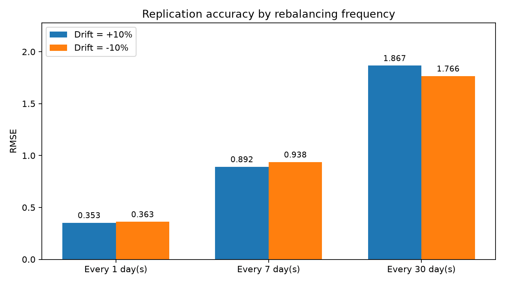
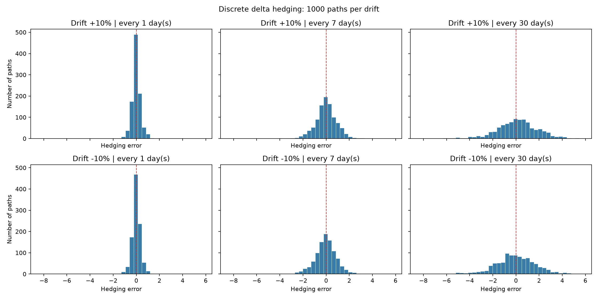
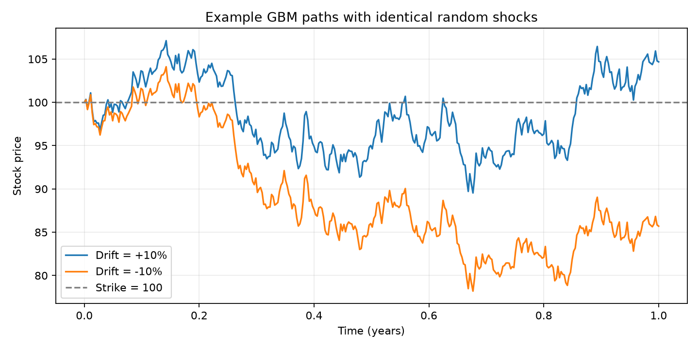

# Discrete Delta Hedging Simulation

使用 Python 模拟欧式看涨期权的自融资复制组合，比较调仓频率和股票真实漂移率对复制误差的影响。

## 实验设置

- 股票服从 GBM，初始股价与行权价均为 100，期限 1 年。
- 年化波动率 20%，无风险利率 5%，真实漂移率分别为 +10% 和 −10%。
- 一年分为 365 个模拟时间间隔，每种 drift 生成 1000 条路径。
- 每隔 1、7、30 天调仓，种子固定为 42；两种 drift 配对使用相同随机冲击。
- 无股息、无交易成本，允许碎股交易，借款与存款利率相同；未使用真实交易日历。

## 结果

到期复制误差定义为 **组合价值 − 期权到期收益**。平均误差衡量偏向盈余还是不足；RMSE 避免正负抵消，越小表示总体复制越准确。

| Drift | 调仓间隔 | 平均误差 | RMSE |
|---|---:|---:|---:|
| +10% | 1 天 | −0.0130 | 0.3533 |
| +10% | 7 天 | +0.0026 | 0.8922 |
| +10% | 30 天 | +0.0699 | 1.8667 |
| −10% | 1 天 | −0.0132 | 0.3625 |
| −10% | 7 天 | −0.0485 | 0.9375 |
| −10% | 30 天 | −0.0504 | 1.7658 |





本次实验中，两种 drift 下更频繁的调仓均得到更低的 RMSE。真实 drift 不影响 Black–Scholes 初始价格和 Delta，但可以改变离散对冲误差的分布。初始期权价格约为 10.4506，Delta 约为 0.6368。



## 阅读与运行

- [Delta_Hedging.ipynb](Delta_Hedging.ipynb)：完整中文说明、代码、已保存的运行输出和图表。
- [实验报告.md](实验报告.md)：模型、方法、结论与局限。
- [delta_hedging_clean.py](delta_hedging_clean.py)：对应的脚本版本。
- [results/summary.csv](results/summary.csv)：六组统计结果。
- [results/path_errors.csv](results/path_errors.csv)：每条路径的复制误差。

```bash
python -m pip install -r requirements.txt
python delta_hedging_clean.py
```

脚本依赖 NumPy 和 Matplotlib，结果保存到脚本旁的 `results/`。脚本依次显示三幅图，关闭当前图窗后继续；重新运行会更新同名结果文件。

也可以在 VS Code 或 Jupyter 中打开 Notebook，选择已安装上述依赖的 Python 内核，从上到下运行所有单元。Notebook 的结果目录相对于内核工作目录。Notebook 与脚本是两种运行入口，选择一种即可。

## 局限

路径生成与定价采用同一个常波动率 GBM 模型，未考虑交易成本、跳跃、随机波动率或融资约束。1000 条路径存在抽样误差，未计算置信区间；两种 drift 之间的小差异不能据此解释为稳定规律。这是模型内的复制实验，未验证真实市场的对冲效果。
