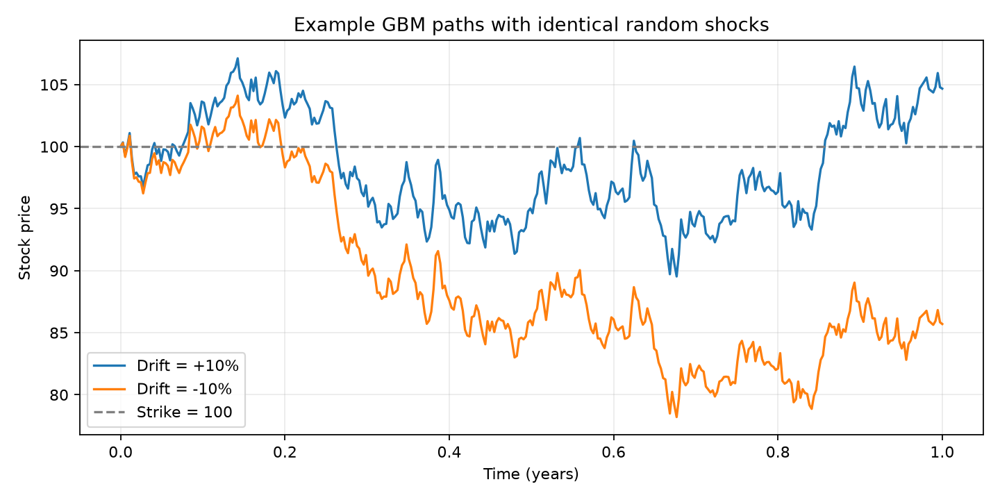
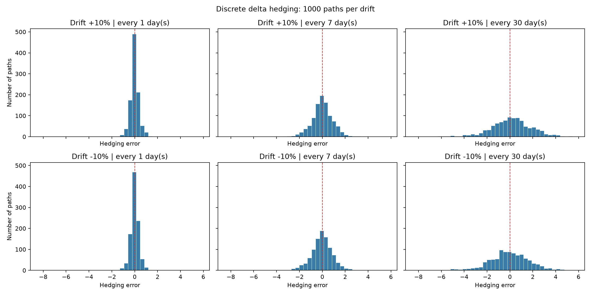
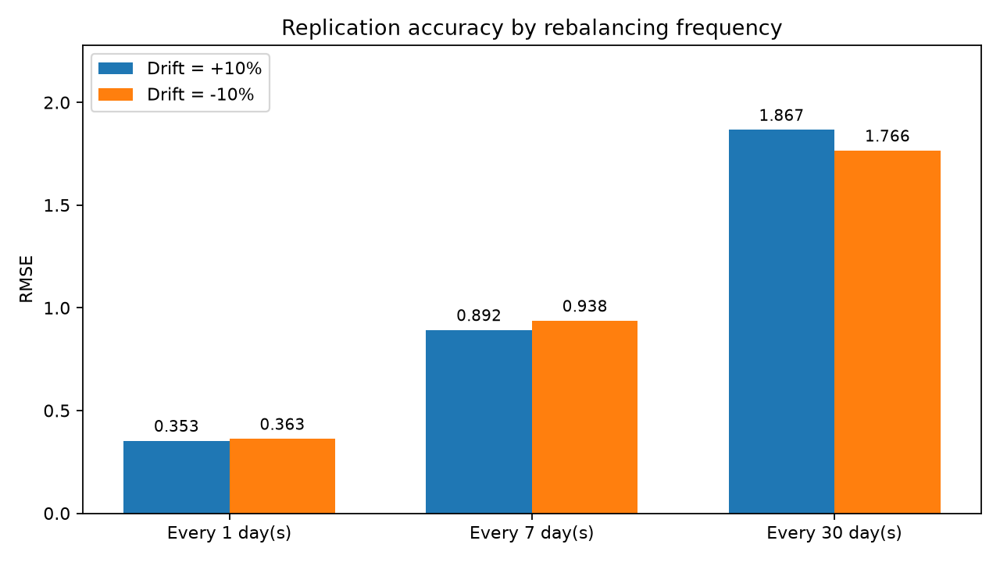

# Discrete Delta Hedging Simulation

## 1. Research questions and assumptions

Replicate a European call option using a stock position and a cash account, and examine:

- How does the replication error change when the position is rebalanced every 1, 7 or 30 days?
- What changes when the stock's physical drift moves from +10% to -10%?

The stock follows constant-volatility GBM. There are no dividends or transaction costs, fractional shares are allowed, and borrowing and lending use the same continuously compounded rate. The year is divided into 365 simulation intervals. Seven and thirty days are fixed intervals rather than actual trading-calendar weeks and months.

This notebook retains the outputs of the completed baseline run. To rerun it, execute all cells from top to bottom, including after changing parameters.

## 2. Parameters

The initial stock price and strike are both 100, maturity is one year, annualized volatility is 20%, and the risk-free rate is 5%. Each drift scenario uses 1,000 paths and seed 42. The learning implementation's variable names P, step and drift are retained.

## 3. Initial price and holdings

Let time to maturity be $\tau$ and the current stock price be $S$:

$$d_1=\frac{\ln(S/K)+(r+\sigma^2/2)\tau}{\sigma\sqrt{\tau}},\qquad d_2=d_1-\sigma\sqrt{\tau}.$$

$$C=S\Phi(d_1)-Ke^{-r\tau}\Phi(d_2),\qquad \Delta=\Phi(d_1).$$

Initially hold $\Delta_0$ shares and cash $B_0=C_0-\Delta_0P$. Negative cash represents borrowing. The portfolio initially matches both the option's theoretical value and its sensitivity to a small stock-price change. The physical drift does not enter these formulas.

## 4. Path generation and self-financing hedging

$$S_{t+\Delta t}=S_t\exp\left[(\mu-\sigma^2/2)\Delta t+\sigma\sqrt{\Delta t}Z\right],\quad Z\sim N(0,1).$$

This is the exact GBM update between grid points. The replication error comes from discrete rebalancing rather than an Euler approximation to this price update.

At each time step, first accrue cash interest using $B\leftarrow Be^{r\Delta t}$. On a rebalancing date, calculate the new Delta and update cash:

$$B\leftarrow B-(\Delta_{\rm new}-\Delta_{\rm old})S.$$

Buying shares consumes cash and selling shares releases cash. With no transaction costs, the trade leaves total portfolio value unchanged. Cash is not reset to the theoretical option value by injecting or withdrawing funds. Delta is evaluated only before expiry, avoiding a zero remaining maturity.

The terminal error is $E=V_T-\max(S_T-K,0)$. A positive value is a surplus after paying the option payoff; a negative value is a shortfall. The function uses the model parameters defined above, so changing them requires rerunning the initial pricing cell.

## 5. Monte Carlo experiments and evaluation metrics

Evaluate all three rebalancing intervals on each price path. Reset the seed for each drift scenario so corresponding paths share the same random shocks; do not reset the generator inside a scenario's path loop.

$$\overline E=\frac1M\sum_{j=1}^M E_j,\qquad \mathrm{RMSE}=\sqrt{\frac1M\sum_{j=1}^M E_j^2}.$$

The mean error measures the average surplus or shortfall. RMSE prevents positive and negative errors from cancelling; a lower value indicates more accurate overall replication.

## 6. Recorded baseline results

| Drift | Interval (days) | Mean error | RMSE |
|---|---:|---:|---:|
| +10% | 1 | -0.0130 | 0.3533 |
| +10% | 7 | +0.0026 | 0.8922 |
| +10% | 30 | +0.0699 | 1.8667 |
| -10% | 1 | -0.0132 | 0.3625 |
| -10% | 7 | -0.0485 | 0.9375 |
| -10% | 30 | -0.0504 | 1.7658 |

Initial option price: 10.4505835722; Delta: 0.6368306512; cash: -53.2324815454.

## 7. Findings and limitations

1. In these simulations, shorter rebalancing intervals reduce RMSE under both drift assumptions. More frequent trades allow holdings to follow the changing Delta more closely.
2. A mean error near zero does not imply accurate replication on individual paths. With +10% drift, weekly rebalancing has a mean closer to zero than daily rebalancing, but a higher RMSE.
3. Physical drift does not affect the initial Black-Scholes price or Delta. It changes simulated paths and the distribution of discrete hedging errors. Changing drift did not uniformly increase or decrease RMSE in these runs.
4. Continuous rebalancing replicates the payoff in the ideal model. Discrete rebalancing leaves random error, so a surplus on one path does not establish a reliable profit strategy.

The simulation and pricing model use the same constant-volatility GBM assumptions. Transaction costs, stochastic volatility, jumps, dividends, financing constraints and market data are excluded. Each scenario has 1,000 paths, and confidence intervals were not estimated. Small differences between drift scenarios are subject to sampling error. These experiments assess replication within the model rather than real-market hedging performance.

## 8. Exported data

`summary.csv` contains the six summary rows. `path_errors.csv` contains pathwise errors for 1,000 paths under each drift assumption. The figure cells save PNG files in the results directory.
