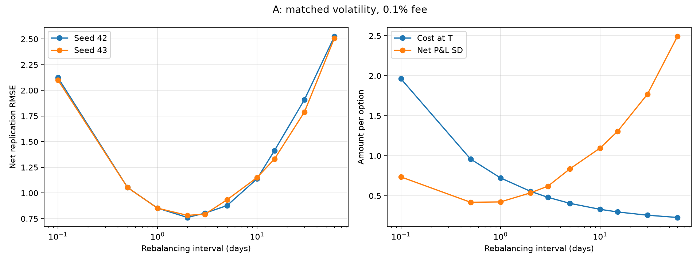
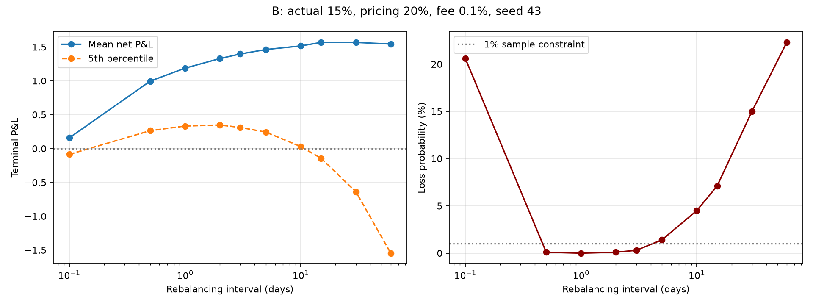

# Optimal Hedging and Volatility Trading

The tables and figures below come from the completed simulation run. The standalone program starts from random GBM paths and does not read previously transcribed terminal results. The exported summaries were independently checked by recomputing statistics from 61,000 pathwise P&L records.

## 1. Parameters and reproducibility

| Parameter | Setting |
|---|---|
| Initial stock price and strike | 100 and 100 |
| Maturity, risk-free rate and physical drift | 1 year, 5% and 10% |
| Pricing and hedging volatility | 20% |
| Actual volatility | A: 20%; B: 15%, 20% and 25% |
| Time grid and paths per configuration | 10 steps per day, 0.1 day per step; 1,000 paths |
| Candidate intervals (days) | 0.1, 0.5, 1, 2, 3, 5, 10, 15, 30, 60 |
| Proportional transaction-cost rate | 0 or 0.1% of stock traded |
| Seeds | A: 42 and 43; B selection: 43; B validation: 44 |
| NumPy version used for the recorded run | 2.5.3 |

There are no dividends; fractional shares are allowed; borrowing and lending use the same interest rate. Fees cover the initial stock position, rebalancing trades and terminal stock liquidation. The model uses fixed calendar-time increments rather than an actual trading calendar. B's seed-43 volatility scenarios use paired random shocks.

## 2. Method and evaluation metrics

$$S_{t+\Delta t}=S_t\exp\left[(\mu-\sigma_{actual}^2/2)\Delta t+\sigma_{actual}\sqrt{\Delta t}Z\right],\quad Z\sim N(0,1).$$

The option price and Delta use the pricing volatility. The initial price is approximately 10.4506 and Delta is approximately 0.6368. The option premium funds a stock-and-cash portfolio; subsequent trades are self-financing.

$$\Pi_T=V_T-\max(S_T-K,0).$$

Portfolio value includes all trading costs. Interpreting the strategy as selling the call and hedging it, a positive value is the surplus remaining after settlement. P&L is measured per option on one share, not as a return on equity.

- Mean: average terminal net P&L. SD: sample standard deviation, using ddof=1.
- RMSE: $\sqrt{M^{-1}\sum_j\Pi_j^2}$, used for A's replication objective.
- Costs at maturity: transaction costs accumulated to expiry, including their financing effect.
- Sample loss rate: the fraction of paths with negative net P&L.
- 5th percentile: a threshold below which approximately 5% of sample outcomes fall, not the average of the worst 5%.

The accounting identity is net P&L + accumulated costs = gross P&L on each path. The code checks this against an independent zero-cost calculation. The exported pathwise data and all summary statistics were also checked independently.

## 3. A: Rebalancing frequency with transaction costs

Actual and pricing volatility are both 20%, with a 0.1% proportional fee. The objective is to minimize net replication RMSE over the candidate intervals.

| Seed | Interval (days) | Mean error | SD | RMSE | Costs at maturity |
|---|---|---|---|---|---|
| 42 | 0.1 | -1.9962 | 0.7286 | 2.1248 | 1.9973 |
| 42 | 0.5 | -0.9738 | 0.4049 | 1.0546 | 0.9756 |
| 42 | 1 | -0.7370 | 0.4301 | 0.8532 | 0.7335 |
| 42 | 2 | -0.5634 | 0.5134 | 0.7620 | 0.5628 |
| 42 | 3 | -0.4850 | 0.6415 | 0.8040 | 0.4856 |
| 42 | 5 | -0.3997 | 0.7820 | 0.8779 | 0.4081 |
| 42 | 10 | -0.3462 | 1.0848 | 1.1382 | 0.3338 |
| 42 | 15 | -0.2936 | 1.3841 | 1.4143 | 0.3003 |
| 42 | 30 | -0.3009 | 1.8871 | 1.9100 | 0.2597 |
| 42 | 60 | -0.2579 | 2.5138 | 2.5258 | 0.2301 |
| 43 | 0.1 | -1.9684 | 0.7358 | 2.1013 | 1.9626 |
| 43 | 0.5 | -0.9671 | 0.4191 | 1.0540 | 0.9599 |
| 43 | 1 | -0.7405 | 0.4231 | 0.8527 | 0.7235 |
| 43 | 2 | -0.5701 | 0.5363 | 0.7825 | 0.5559 |
| 43 | 3 | -0.4960 | 0.6201 | 0.7938 | 0.4805 |
| 43 | 5 | -0.4144 | 0.8377 | 0.9343 | 0.4049 |
| 43 | 10 | -0.3525 | 1.0954 | 1.1502 | 0.3307 |
| 43 | 15 | -0.2750 | 1.3042 | 1.3323 | 0.2978 |
| 43 | 30 | -0.2711 | 1.7704 | 1.7901 | 0.2570 |
| 43 | 60 | -0.3047 | 2.4920 | 2.5093 | 0.2288 |

Both batches select **2 days**. RMSE is **0.7620** for seed 42 and **0.7825** for seed 43. Very frequent trading increases costs; long gaps increase discrete replication error. This finding applies to the stated parameters and candidate grid. The difference between 2 and 3 days is small, particularly in the second batch.

## 4. B: Actual versus pricing volatility

First remove transaction costs, hold pricing volatility at 20%, and rebalance every 0.1 day:

| Actual volatility | Mean P&L | SD | Sample loss rate |
|---|---:|---:|---:|
| 15% | 1.8251 | 0.6922 | 0.0% |
| 20% | -0.0058 | 0.1155 | 52.8% |
| 25% | -1.9162 | 0.8550 | 100.0% |

Average hedged P&L is positive when actual volatility is below pricing volatility, close to zero when they match, and negative when actual volatility is higher. In the ideal continuous-hedging model without costs:

$$\Pi_T=\frac12\int_0^T e^{r(T-t)}\Gamma_t S_t^2(\sigma_{hedge}^2-\sigma_{actual}^2)\,dt.$$

P&L therefore depends on the variance difference weighted by Gamma and the stock price along the path. Those weights are random; even continuous hedging need not produce a constant P&L when the volatilities differ.

## 5. B: Costs, policy selection and independent validation

Actual volatility is 15%, pricing volatility is 20%, the fee is 0.1%, and the selection seed is 43. The completed run covers all ten candidate intervals:

| Interval (days) | Mean net P&L | SD | Costs at maturity | Sample loss rate | 5th percentile |
|---|---|---|---|---|---|
| 0.1 | 0.1577 | 0.1768 | 1.6673 | 20.6% | -0.0857 |
| 0.5 | 0.9950 | 0.4970 | 0.8301 | 0.1% | 0.2634 |
| 1 | 1.1866 | 0.5945 | 0.6326 | 0.0% | 0.3321 |
| 2 | 1.3284 | 0.6986 | 0.4934 | 0.1% | 0.3472 |
| 3 | 1.3960 | 0.7758 | 0.4307 | 0.3% | 0.3115 |
| 5 | 1.4618 | 0.8970 | 0.3671 | 1.4% | 0.2421 |
| 10 | 1.5148 | 1.0704 | 0.3061 | 4.5% | 0.0289 |
| 15 | 1.5672 | 1.2204 | 0.2791 | 7.1% | -0.1446 |
| 30 | 1.5667 | 1.5368 | 0.2460 | 15.0% | -0.6390 |
| 60 | 1.5434 | 2.0185 | 0.2230 | 22.3% | -1.5452 |

Frequent trading can consume the gain from the volatility difference. Longer intervals reduce costs but can worsen lower-tail outcomes and loss rates.

Selection rule: **maximize mean net P&L subject to a sample loss rate no greater than 1%**. The full grid selects **3 days**, with mean net P&L **1.3960**. The 3-day policy was fixed before evaluation on seed 44; the validation sample was not used to reselect the interval.

| Seed | Interval (days) | Mean net P&L | SD | Sample loss rate | 5th percentile |
|---|---|---|---|---|---|
| 43 | 3 | 1.3960 | 0.7758 | 0.3% | 0.3115 |
| 44 | 3 | 1.4224 | 0.7532 | 0.2% | 0.3172 |

The validation sample contains **2 losses out of 1,000 paths**, with mean net P&L **1.4224**. It satisfies the sample constraint; this does not establish that the population loss probability is below 1%. A's 2-day choice and B's 3-day choice answer different questions under different parameters.

## 6. Data checks and limitations

The completed run contains **61 configurations and 61,000 pathwise P&L records**, with 1,000 unique path IDs in each configuration. Different strategies reuse price paths, so these are not 61,000 independent stock paths. Mean, SD, RMSE, loss rate, 5th percentile and average costs were independently recomputed from the pathwise data and matched the summaries within 1e-9.

The model excludes jumps, stochastic volatility, actual trading calendars, dividends, financing constraints and market data. Future actual volatility is unknown in practice; the assumed 15% is a simulation input, not information available in advance to a trader. Each configuration has 1,000 paths, so means and risk metrics remain subject to sampling uncertainty.

## 7. Reproduce the run

Run `python experiments_ab.py`. The program generates random paths, calculates holdings and costs, summarizes P&L and saves figures in `results/rerun/` next to the script. It does not use previous output files as inputs. The notebook provides the same code below; the tables and figures above already contain the completed run's results.
