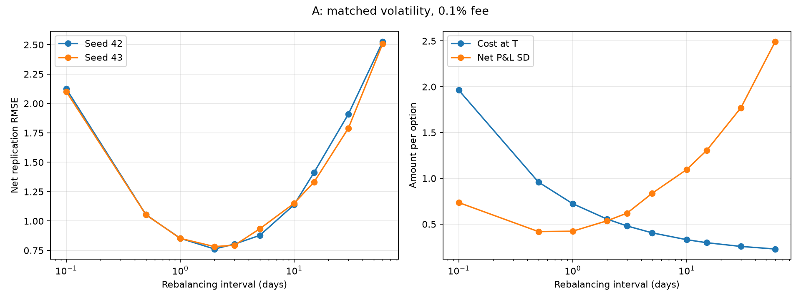
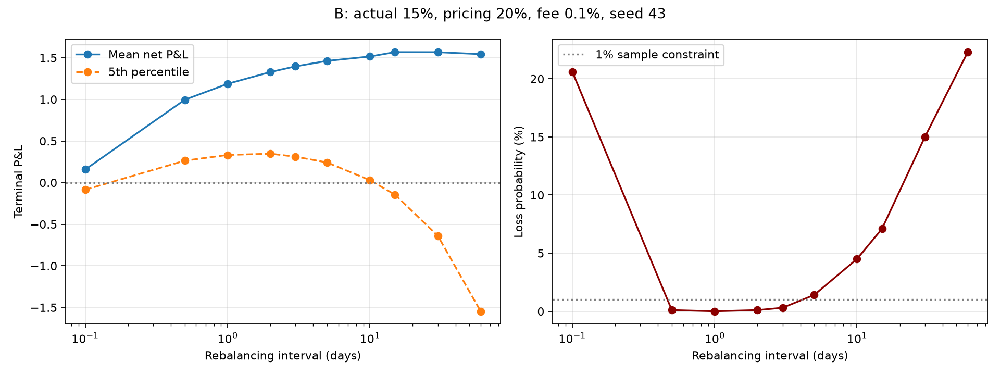

# Optimal Hedging 与 Volatility Trading：实际重跑结果

**本报告全部表格和图片均来自实际运行的程序输出。** 输入为随机生成的 GBM 股价路径；程序不读取用户此前提供的终端记录，也不读取旧的 reported_results.csv。Notebook 在用户的 Python 内核完成了计算，本次整理再从 61,000 条逐路径记录独立重算统计，核对导出文件。

## 1. 参数与运行来源

| 参数 | 设置 |
|---|---|
| 初始股价、行权价 | 100、100 |
| 期限、无风险利率、真实 drift | 1 年、5%、10% |
| 定价与 Delta 波动率 | 20% |
| 实际波动率 | A：20%；B：15%、20%、25% |
| 时间网格、每组路径数 | 每天 10 步，每步 0.1 天；1000 条路径 |
| 候选间隔（天） | 0.1、0.5、1、2、3、5、10、15、30、60 |
| 费率 | 0 或交易金额的 0.1% |
| 种子 | A：42、43；B 筛选：43；B 验证：44 |
| NumPy | 2.5.3 |

无股息、允许碎股交易、借款和存款同利率。计入初始建仓、调仓和到期股票平仓费用；不处理真实交易日历。不同实际波动率的种子 43 实验配对使用相同随机冲击。

## 2. 方法与评价指标

$$S_{t+\Delta t}=S_t\exp\left[(\mu-\sigma_{actual}^2/2)\Delta t+\sigma_{actual}\sqrt{\Delta t}Z\right],\quad Z\sim N(0,1).$$

期权价格与 Delta 用定价波动率计算，初始价格约 10.4506，Delta 约 0.6368。用收到的期权费建立股票与现金组合，后续调仓通过现金账户自融资。

$$\Pi_T=V_T-\max(S_T-K,0).$$

组合价值已扣除交易费用。把策略解释为卖出期权并对冲，正值表示履约后有盈余。

- Mean：到期净损益均值；Std：样本标准差，ddof=1。
- RMSE：$\sqrt{M^{-1}\sum_j\Pi_j^2}$，用于 A 的复制目标。
- Cost at T：所有手续费及其融资影响折算到期的金额。
- Loss probability：样本中净损益小于零的比例。
- 第 5 百分位：约有 5% 的样本低于该损益阈值，不是最差 5% 样本的平均值。

完整成本核对为：同路径净损益 + 成本到期值 = 无成本损益。代码内部核对了零费用的独立计算；整理时又核对了逐路径导出文件及全部汇总指标。

## 3. A：含成本复制频率

实际与定价波动率均为 20%，费率为 0.1%。目标为候选频率中的净复制 RMSE 最小。

| 种子 | 间隔（天） | 平均误差 | 标准差 | RMSE | 成本到期值 |
|---|---|---|---|---|---|
| 42 | 0.1 | -1.9962 | 0.7286 | 2.1248 | 1.9973 |
| 42 | 0.5 | -0.9738 | 0.4049 | 1.0546 | 0.9756 |
| 42 | 1 | -0.7370 | 0.4301 | 0.8532 | 0.7335 |
| 42 | 2 | -0.5634 | 0.5134 | 0.7620 | 0.5628 |
| 42 | 3 | -0.4850 | 0.6415 | 0.8040 | 0.4856 |
| 42 | 5 | -0.3997 | 0.7820 | 0.8779 | 0.4081 |
| 42 | 10 | -0.3462 | 1.0848 | 1.1382 | 0.3338 |
| 42 | 15 | -0.2936 | 1.3841 | 1.4143 | 0.3003 |
| 42 | 30 | -0.3009 | 1.8871 | 1.9100 | 0.2597 |
| 42 | 60 | -0.2579 | 2.5138 | 2.5258 | 0.2301 |
| 43 | 0.1 | -1.9684 | 0.7358 | 2.1013 | 1.9626 |
| 43 | 0.5 | -0.9671 | 0.4191 | 1.0540 | 0.9599 |
| 43 | 1 | -0.7405 | 0.4231 | 0.8527 | 0.7235 |
| 43 | 2 | -0.5701 | 0.5363 | 0.7825 | 0.5559 |
| 43 | 3 | -0.4960 | 0.6201 | 0.7938 | 0.4805 |
| 43 | 5 | -0.4144 | 0.8377 | 0.9343 | 0.4049 |
| 43 | 10 | -0.3525 | 1.0954 | 1.1502 | 0.3307 |
| 43 | 15 | -0.2750 | 1.3042 | 1.3323 | 0.2978 |
| 43 | 30 | -0.2711 | 1.7704 | 1.7901 | 0.2570 |
| 43 | 60 | -0.3047 | 2.4920 | 2.5093 | 0.2288 |

两批路径的最优候选均为 **2 天**。种子 42 的 RMSE 为 **0.7620**，种子 43 为 **0.7825**。过于频繁的调仓提高成本；过长间隔增加复制误差。结论限于当前参数与候选网格，且 2 天与 3 天的差距较小。

## 4. B：波动率差异

首先关闭交易成本，固定定价波动率 20%，比较每 0.1 天调仓的结果：

| 实际波动率 | 平均损益 | 标准差 | 亏损比例 |
|---|---:|---:|---:|
| 15% | 1.8251 | 0.6922 | 0.0% |
| 20% | -0.0058 | 0.1155 | 52.8% |
| 25% | -1.9162 | 0.8550 | 100.0% |

实际波动率低于定价波动率时平均盈利；相同时接近零；实际波动率更高时平均亏损。对于当前无成本连续对冲的理想模型：

$$\Pi_T=\frac12\int_0^T e^{r(T-t)}\Gamma_t S_t^2(\sigma_{hedge}^2-\sigma_{actual}^2)\,dt.$$

因此损益取决于路径上的 Gamma 和股价加权方差差。该关系中的权重本身随机；波动率不一致时，连续对冲损益也不必是固定常数。

## 5. B：加入成本、筛选与独立验证

实际波动率 15%、定价波动率 20%、费率 0.1%，种子 43。以下为全部十个候选频率的新计算结果：

| 间隔（天） | 平均净损益 | 标准差 | 成本到期值 | 亏损比例 | 第5百分位 |
|---|---|---|---|---|---|
| 0.1 | 0.1577 | 0.1768 | 1.6673 | 20.6% | -0.0857 |
| 0.5 | 0.9950 | 0.4970 | 0.8301 | 0.1% | 0.2634 |
| 1 | 1.1866 | 0.5945 | 0.6326 | 0.0% | 0.3321 |
| 2 | 1.3284 | 0.6986 | 0.4934 | 0.1% | 0.3472 |
| 3 | 1.3960 | 0.7758 | 0.4307 | 0.3% | 0.3115 |
| 5 | 1.4618 | 0.8970 | 0.3671 | 1.4% | 0.2421 |
| 10 | 1.5148 | 1.0704 | 0.3061 | 4.5% | 0.0289 |
| 15 | 1.5672 | 1.2204 | 0.2791 | 7.1% | -0.1446 |
| 30 | 1.5667 | 1.5368 | 0.2460 | 15.0% | -0.6390 |
| 60 | 1.5434 | 2.0185 | 0.2230 | 22.3% | -1.5452 |

频繁调仓的成本会侵蚀波动率差带来的收益；较长间隔虽然成本较少，但左尾损益和亏损比例会恶化。

筛选规则：**样本亏损比例不超过 1%，同时平均净损益最高**。完整候选网格选出 **3 天**，筛选样本均值为 **1.3960**。验证策略事先固定为 3 天，仅在新种子 44 上评估，不用验证集重新选频率。

| 种子 | 间隔（天） | 平均净损益 | 标准差 | 亏损比例 | 第5百分位 |
|---|---|---|---|---|---|
| 43 | 3 | 1.3960 | 0.7758 | 0.3% | 0.3115 |
| 44 | 3 | 1.4224 | 0.7532 | 0.2% | 0.3172 |

验证样本中有 **2/1000** 条路径亏损，平均净收益为 **1.4224**。它满足当前样本约束，不保证真实亏损概率小于 1%。A 的 2 天与 B 的 3 天对应不同参数和目标。

## 6. 数据核对与局限

共 **61** 组汇总、**61,000** 条逐路径损益，每组 1000 条，无重复路径编号。已从逐路径净损益独立重算均值、标准差、RMSE、亏损比例、第 5 百分位和平均成本，均与导出汇总一致（最大偏差小于 1e-9）。

模型未包含跳跃、随机波动率、真实交易日历、股息、融资约束或真实行情。市场中的未来实际波动率未知；本实验预设的 15% 不代表可提前知道的交易信息。1000 条路径下的均值和风险指标仍有抽样误差。

## 7. 重跑

运行 `python experiments_ab.py`，程序从随机数开始生成路径、计算持仓与费用、汇总统计并画图。新输出写入脚本旁的 `results/rerun/`。不依赖旧结果文件。Notebook 下方提供同样的重跑代码；上方表图已经来自本次实际运行，无须为了阅读而再跑一遍。