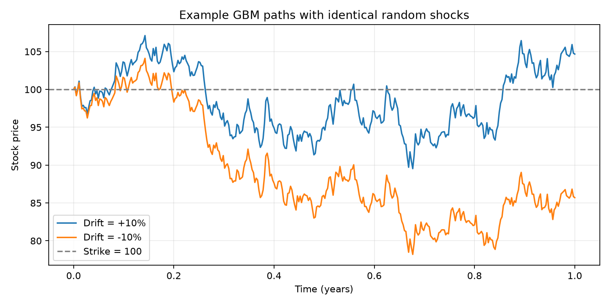
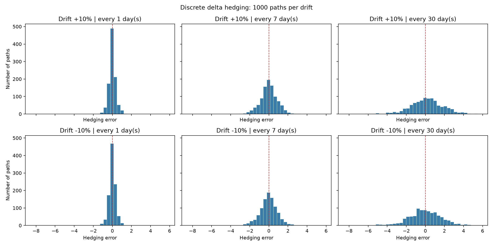
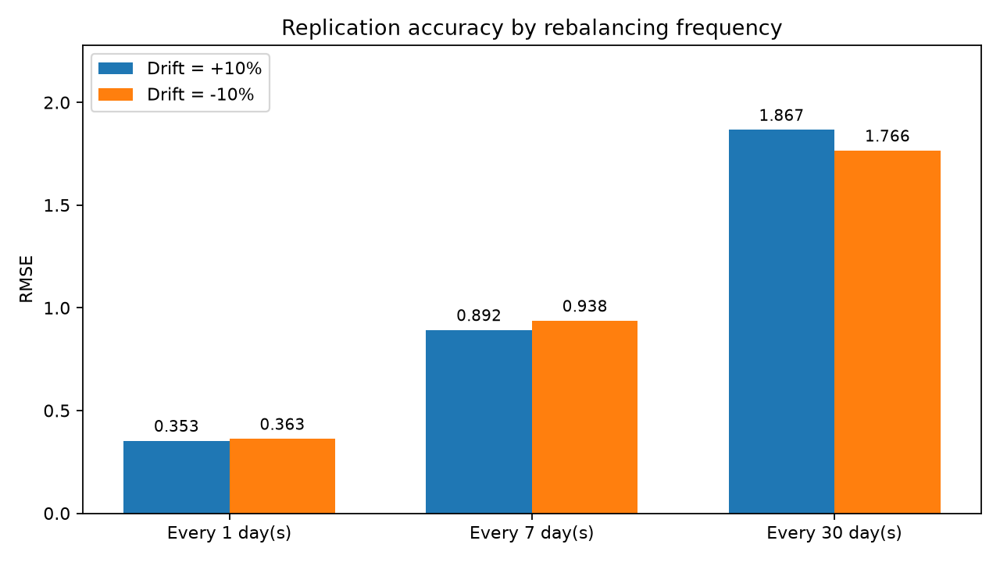

# 离散 Delta 对冲模拟

## 1. 研究问题与假设

用股票和现金账户复制一份欧式看涨期权，观察：

- 调仓间隔为 1、7、30 天时，复制误差如何变化？
- 股票真实漂移率从 +10% 变为 −10% 时，理论定价与离散对冲表现如何变化？

假设股票服从常波动率 GBM，无股息、无交易成本，允许碎股交易；借款与存款采用相同的连续复利利率。365 表示一年划分为 365 个模拟间隔，7 天和 30 天是固定间隔，未处理真实交易日历。

本文件已保存一次完整运行的输出。重新运行时请从上到下运行全部单元；修改参数后也应重新运行全部单元。

## 2. 参数

初始股价与行权价均为 100，期限 1 年，年化波动率 20%，无风险利率 5%。每种 drift 模拟 1000 条路径，种子为 42。沿用学习时的变量名 P、step、drift。

## 3. 初始价格与持仓

记剩余期限为 $\tau$，当前股价为 $S$：

$$d_1=\frac{\ln(S/K)+(r+\sigma^2/2)\tau}{\sigma\sqrt{\tau}},\qquad d_2=d_1-\sigma\sqrt{\tau}.$$

$$C=S\Phi(d_1)-Ke^{-r\tau}\Phi(d_2),\qquad \Delta=\Phi(d_1).$$

初始持有 $\Delta_0$ 股，现金 $B_0=C_0-\Delta_0P$。负现金表示借款。初始组合价值等于期权理论价格，且对股价小幅变化的敏感度相同。真实漂移率不出现在这两个公式中。

## 4. 路径生成与自融资对冲

$$S_{t+\Delta t}=S_t\exp\left[(\mu-\sigma^2/2)\Delta t+\sigma\sqrt{\Delta t}Z\right],\quad Z\sim N(0,1).$$

这是 GBM 在网格时点之间的精确更新；复制误差来自离散调仓，而非该更新公式的 Euler 离散误差。

每个时点先更新现金 $B\leftarrow Be^{r\Delta t}$。如果需要调仓，则计算新的 Delta，并执行：

$$B\leftarrow B-(\Delta_{\rm new}-\Delta_{\rm old})S.$$

买股消耗现金，卖股增加现金。调仓瞬间组合总价值保持不变；不通过补钱让现金余额强行回到理论值。循环只到到期前，到期不计算剩余期限为零的 Delta。

最终误差 $E=V_T-\max(S_T-K,0)$；正值表示支付期权收益后有盈余，负值表示不足。函数沿用前面定义的模型参数，修改参数后要重新运行初始定价。

## 5. 批量实验与评价指标

每条路径分别测试三种调仓频率。两种 drift 重新使用相同种子，使对应路径使用相同随机冲击；每种 drift 内不重置生成器。

$$\overline E=\frac1M\sum_{j=1}^M E_j,\qquad \mathrm{RMSE}=\sqrt{\frac1M\sum_{j=1}^M E_j^2}.$$

平均误差反映偏向盈余还是不足；RMSE 避免正负误差抵消，越小表示总体复制越准确。

## 实际运行结果

| Drift | 调仓间隔 | 平均误差 | RMSE |
|---|---:|---:|---:|
| +10% | 1 天 | -0.0130 | 0.3533 |
| +10% | 7 天 | +0.0026 | 0.8922 |
| +10% | 30 天 | +0.0699 | 1.8667 |
| -10% | 1 天 | -0.0132 | 0.3625 |
| -10% | 7 天 | -0.0485 | 0.9375 |
| -10% | 30 天 | -0.0504 | 1.7658 |

初始期权价格约 10.4505835722，Delta 约 0.6368306512，初始现金约 −53.2324815454。

## 7. 结论与局限

1. 本次实验中，两种 drift 下 RMSE 均随调仓间隔缩短而下降。更频繁更新持仓，使持股数量更及时地跟随 Delta。
2. 平均误差接近零不等于逐条路径准确，例如 +10% drift 下每周调仓的平均误差更接近零，但 RMSE 大于每天调仓。
3. 真实 drift 不影响初始 Black–Scholes 价格和 Delta；它改变路径及离散对冲误差分布。本次改变 drift 后，RMSE 没有统一增大或减小。
4. 连续调仓的理想模型能够复制期权，离散调仓则留下随机误差，不能将单条路径的盈余视为稳定盈利策略。

局限：路径生成与定价采用相同 GBM 模型，未考虑交易成本、随机波动率、跳跃、股息、融资约束或真实行情。1000 条路径有抽样误差，未计算置信区间，不能把两组 drift 间的小差异当作稳定规律。本项目验证模型内的复制行为，不构成真实市场表现验证。
